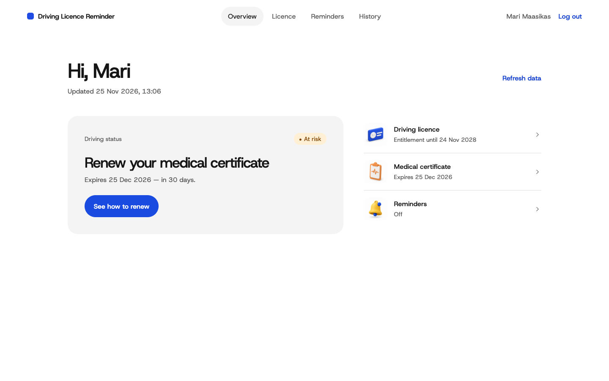

# ITE4120 — Driving Licence Reminder



Team: Rene Korss, Cibele Yuri Kojima De Paula, Dwitama Alfret Wuwung.

## Run the full app locally

Start Docker with Compose v2.24.4 or newer. Install Node.js 22.12+ (or Node 20.19+
on the 20.x line), npm, a POSIX shell and OpenSSL. From the repository root run
one command:

```sh
./scripts/start-web.sh
```

Open the **Local** address printed in the terminal (normally http://127.0.0.1:5173). Choose Smart-ID, Mobile-ID or ID-card,
then select **Demo accounts**. Each choice uses a synthetic personal code. Try
`00000000002` for an expiring licence or `00000000007` for an expiring medical
certificate. Open **Licence → Refresh data** to check both registries.

The launcher creates local configuration and secrets, starts PostgreSQL, applies
migrations, builds the API, starts the X-Road mock and reminder worker, seeds
the demo accounts and installs the locked frontend dependencies. Keep the
terminal open while testing. On the first run, allow time and internet access
for Docker images and packages. Rerun the same command to resume with saved
accounts, preferences and history. If port 5173 is occupied, Vite automatically tries successive ports.

Press Ctrl+C to stop the frontend. To also stop the backend services while
retaining the database, run:

```sh
docker compose -f compose.yaml -f compose.mock.yaml -f compose.api.yaml -f compose.web.yaml down
```

The [story acceptance audit](docs/acceptance.md) maps all 13 stories to their
checks and identifies external acceptance gates. The [web guide](docs/web.md)
lists all seven accounts, browser notification delivery steps and test commands.
Python 3.11+ is needed for the host-side repository and mock tests.

## Run the API independently

```sh
./scripts/init-local.sh
docker compose -f compose.yaml -f compose.mock.yaml -f compose.api.yaml up -d --build --wait api
```

Local configuration is in `.env`, created from `.env.example`. The setup script
also generates local secrets in `.secrets/`; both are ignored by Git.

API and interactive docs: **http://127.0.0.1:18080/docs**. Import the
[frontend Postman collection](postman/frontend-api.postman_collection.json) and the
private environment produced by the [explicit account seed command](docs/api.md#run-with-react-or-postman).
See [API documentation and React examples](docs/api.md) for authentication and configuration.

To open a database console:

```sh
docker compose exec postgres sh -c 'psql -U "$POSTGRES_USER" -d "$POSTGRES_DB"'
```

To stop the services while keeping database data:

```sh
docker compose -f compose.yaml -f compose.mock.yaml -f compose.api.yaml down
```

See [operations and test commands](docs/database-operations.md),
[database design and ERD](docs/database.md), and [user stories](user-stories.md).
