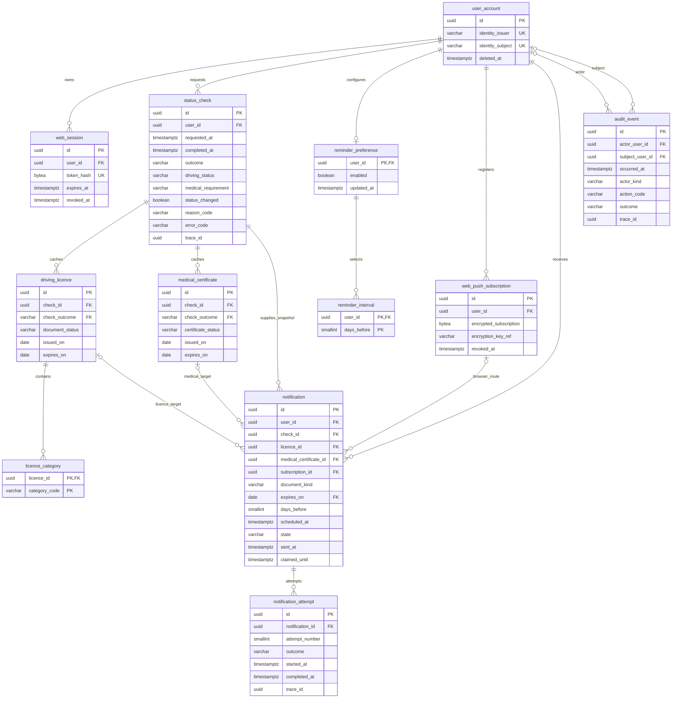

# Database design and requirement traceability

Scope: every acceptance criterion in `user-stories.md`, parent epic and US-01–US-13.
The change request is a complete, proportional relational foundation, not an
implementation of those user flows. SQL constraints are enforced now; transactional
service rules below are contracts for later code and must be tested when implemented.

Authority: [TEHIK NFR v2.4](https://s3-web-1a.tehik.ee/tehik-live-web-prd/s3fs-public/2026-07/mittefunktsionaalsed-nouded.pdf),
[automated-testing requirements](https://s3-web-1a.tehik.ee/tehik-live-web-prd/s3fs-public/2021-01/AV-72518077-280920-1256-30.pdf),
and repository `AGENTS.md`. The older testing PDF references earlier NFR numbering;
use v2.4 numbers for the matrix below.

## Ownership, normalization and minimization

X-Road is the transport, not a database of this application. The Transport Administration
and the provider identified by the eventual medical-data contract remain authoritative.
`status_check`, `driving_licence`, `licence_category`, `medical_certificate` are **local
cached observations**, never registry updates or proof of legal entitlement. Status is
an app-normalized assessment; mapping of source status and risk thresholds is unresolved.
An upstream failure adds a failed check without replacing the latest successful snapshot.
No registry payload, name, national ID, licence number, certificate number, diagnosis,
physician, email, telephone or address is stored. Authentication uses a case-sensitive
opaque `(identity_issuer, identity_subject)` pair, not local passwords. An approved
identity-to-X-Road-subject mapping must be provided before integration; do not silently
substitute a national ID into these fields.

Local authoritative records are the account lifecycle, revocable web sessions, reminder
opt-in/intervals, optional browser subscription, notification delivery evidence and audit
events. The browser owns notification permission; a subscription means permission was
usable at registration time, not permanent permission. Revocation must invalidate it.

Relations are in 3NF where practical: category and interval sets are rows, not arrays;
there is no duplicated latest-status/user deadline column, category catalogue without
metadata, provider catalogue for a single source, guidance CMS, generic settings table,
mobile device table or redundant job schedule table. A check owns its snapshot documents;
all relationships are foreign keys within one schema. Outbox `document_kind` and frozen
`expires_on`, and constant `check_outcome` in cache rows, are deliberate constrained
redundancy: they preserve delivery evidence, validate expiry ownership and ensure cache
rows can reference only successful checks. Notification targets cannot cross users.
Retries have separate attempts because an outbox state alone loses failure history.

## Relations and data dictionary

Exact column types, nullability and constraints are in `database/changelog/001-schema.sql`;
the following explains every persisted field. UUIDs are supplied by a maintained client
library (no personal-data-derived identifiers). `date` means a registry calendar date;
`timestamptz` means an instant, stored/displayed in UTC at the database boundary. Unknown
expiry is NULL and must not produce a fabricated deadline. Missing source data must not
be interpreted as a valid licence or an unnecessary certificate.

| Table | Fields and purpose |
| --- | --- |
| `user_account` | `id` PK; `identity_issuer`, `identity_subject` external opaque identity, 255-character bounds pending IdP contract; `created_at`, nullable `deleted_at` for immediate logical deactivation |
| `web_session` | `id` PK; `user_id` owner; unique `token_hash` exactly 32 bytes for a SHA-256 digest of a high-entropy random bearer token; `created_at`, `expires_at`, nullable `revoked_at`. Hash with a maintained library; secure encrypted cookies and CSRF remain service responsibilities |
| `status_check` | `id` PK; `user_id`; `requested_at`, nullable `completed_at`; `outcome` pending/successful/failed; safe per-operation `trace_id`; optional `xroad_request_id` (255 bound pending contract); fixed `source_code`; successful `driving_status` valid/at_risk/invalid, safe `reason_code`, `medical_requirement` required/not_required/unknown, nullable `status_changed`; failed safe `error_code`. Result shape prevents success/failure fields mixing |
| `driving_licence` | `id` PK is a local snapshot identity, **not** a registry document ID; `check_id`, constant successful `check_outcome`; normalized `document_status`; optional `issued_on`, `expires_on`. A check can have zero/multiple licences pending contract cardinality |
| `licence_category` | Composite PK (`licence_id`, `category_code`); supported Estonian category codes are checked, no extra category metadata invented |
| `medical_certificate` | `id` PK local snapshot identity; `check_id`, successful `check_outcome`; normalized `certificate_status`; optional `issued_on`, `expires_on`. Zero/multiple certificates permitted; medical applicability lives on the check even if no certificate exists |
| `reminder_preference` | `user_id` PK/FK; `enabled` defaults false; `updated_at` records preference update |
| `reminder_interval` | Composite PK (`user_id`, `days_before`); only 90, 30, 7 allowed. Rows are selected intervals, not a global configurable catalogue |
| `web_push_subscription` | `id` PK; `user_id`; `encrypted_subscription` encrypted endpoint/key bundle; `encryption_key_ref` external vault key/version, 128 bound; `created_at`, nullable `revoked_at`. No raw endpoint/token/auth secret in DB or logs |
| `notification` | `id` PK; `user_id`, `check_id`; `document_kind`; exactly one `licence_id` or `medical_certificate_id`; frozen `expires_on`; `days_before`; UTC `scheduled_at`; `channel` in_app/web_push with same-user `subscription_id` required only for web_push; `state` pending/processing/sent/failed/cancelled; processing-only `claimed_until`; sent-only `sent_at`; safe `error_code`; `created_at`. Unique semantic key (`user_id`, `document_kind`, `expires_on`, `days_before`) spans retries and refreshes |
| `notification_attempt` | `id` PK; `notification_id`; positive `attempt_number` unique per notification; `started_at`, nullable `completed_at`; outcome pending/successful/failed/unknown; safe `error_code` required on failure/unknown; per-attempt `trace_id` |
| `audit_event` | `id` PK; `occurred_at`; nullable `actor_user_id`, `subject_user_id`; `actor_kind` user/operator/system/anonymous; safe `action_code`, outcome success/failure/unknown; safe `error_code` required on failure; per-operation `trace_id`. Unauthenticated failed logins can have no account references |

`latest_successful_check` is a view, not stored redundant state. It picks the latest
successful `completed_at`, breaking ties deterministically by UUID. Serialize checks
per user so completion order represents the effective snapshot sequence.
English codes are internal translation keys; future UI must render Estonian text,
for example `valid` → “Kehtiv”, `at_risk` → “Ohus”, `invalid` → “Kehtetu”, and
`XR_TIMEOUT` → “Andmete uuendamine ebaõnnestus. Proovi hiljem uuesti. Veakood: XR_TIMEOUT.”
Do not expose raw source errors or assume these examples finalize product wording.

## Complete ERD



The diagram shows key fields; the dictionary and SQL define all columns. The external
identity UK is composite, as are notification expiry/ownership FKs. Every notification
has exactly one document target; browser subscription is optional only for in-app delivery.
Liquibase `databasechangelog` and `databasechangeloglock` are tool metadata, not domain
entities. No per-user database relations cross schema boundaries.

## Relationships, indexes and deletion

All tables have a PK; dates obey issue ≤ expiry, time intervals cannot run backwards,
and enums are CHECK-constrained varchar codes so they evolve through ordinary changesets.
All FKs have a leading-column index, including composite notification ownership links;
this is checked from PostgreSQL's catalog during integration tests. PK/unique indexes
cover category, interval, attempt and subscription links. Explicit indexes support
user check history, session expiry, due notifications, sent history, pending refreshes
and audit retention. Expensive standalone expiry indexes are unnecessary until the
scheduler query/workload exists; index the outbox's `(state, scheduled_at)` now.

Account deletion cascades sessions, preferences, subscriptions, checks, document caches,
notifications and attempts. Audit actor/subject FKs use NO ACTION, **blocking** hard
delete until the independent custodian anonymizes approved account links. A deleted
account is immediately denied access by later service code checking `deleted_at`;
soft deletion alone does not revoke sessions or cancel delivery automatically.
Snapshots cascade categories and documents on retention purge; notifications use
NO ACTION against their checks/documents/subscriptions so delivery evidence cannot be
orphaned. Delete expired notifications before unneeded snapshots/subscriptions.
Attempts cascade with their notification. No generic soft-delete column is added to
every cache row: bounded snapshots and explicit audit deletion evidence meet that need.

## Required transactional protocols for later services

1. Account creation: insert account, disabled preference and selected intervals 90/30/7
   atomically. Enable only after explicit opt-in. An enabled preference with no selected
   intervals means no deliveries; the UI must explain this or require a choice.
2. Login/logout: create/revoke shared sessions; query only unexpired, unrevoked sessions
   belonging to a non-deleted account. The database stores no replayable bearer token.
   Audit success/failure/logout/expiry, including unknown-user authentication failures.
3. Refresh: serialize work per account (`SELECT ... FOR UPDATE` on `user_account`);
   pending record is durable, request timeouts bounded. On success insert the normalized
   check result and **complete** minimized document set in one transaction. Compare
   status to previous success (`status_changed` NULL for first success, otherwise boolean).
   After commit treat successful snapshots as immutable. Failures store a safe mapped
   error code; do not delete or modify the previous success. Operators resolve abandoned
   pending checks after a configurable timeout, preserving failure evidence.
4. Read: always scope by authenticated user on the server; runtime DB grants alone
   do not provide per-user row isolation. Read `latest_successful_check`, its documents
   and `min` of known relevant licence/certificate expiry dates. Preserve expired dates
   for guidance, and distinguish no deadline from no data. Show successful update time
   and stale-data notice. Use `ORDER BY completed_at DESC, id DESC LIMIT 5` for recent
   completed checks; first successful comparison is “no previous check”, not “changed”.
5. Scheduling: choose the next relevant deadline (coalesce equal-date targets by type),
   selected lead days and active browser delivery route. Insert one outbox row per type/
   expiry/interval. Notification semantic uniqueness implements one logical reminder,
   including repeated refreshes; multiple same-type documents sharing a date are grouped.
   The current schema selects one browser route per logical reminder; multi-device fan-out
   is **not** an accepted requirement. Delivery time zone, daily send time and policy for
   newly enabled reminders whose lead date already passed require product agreement.
6. Before send: lock the same account row used by refresh/settings; verify not deleted,
   reminders still enabled, interval still selected, subscription active, and latest
   successful snapshot still has that next applicable deadline. Cancel obsolete pending/
   failed/processing rows on renewal, changed expiry, interval deselection or disable.
   Re-enable may requeue a cancelled logical row if still relevant; never resend a sent row.
   Keep sent history unchanged; disabling confirmations belong to the future UI.
7. Workers claim due rows atomically with a bounded lease, record each attempt, release
   expired leases, and allow authorised restart of failed jobs. Revalidate before dispatch.
   Configure timeout, maximum attempts and backoff outside SQL. Use notification UUID
   as provider idempotency key if supported. A provider accepting a send followed by a
   worker crash is **unknown**, not safely retryable without provider reconciliation.
   Unique constraints prevent duplicate queue items, not exactly-once external delivery.
   Define the dispatch/disable race boundary with the delivery contract; a committed
   disable must block subsequent dispatch, while an already accepted send cannot be recalled.
8. History: filter `sent_at IS NOT NULL`, `ORDER BY sent_at DESC, id DESC LIMIT` a bounded
   configured count. Render message/action from version-controlled Estonian translation
   templates and frozen target/date; avoid storing unnecessary message bodies. Retention
   limits storage separately from the UI history limit.

## User-story mapping and acceptance coverage

Every row maps to `001-schema.sql`, grants in `002-access.sql`, and named assertions
in `database/tests/integration.sql`. `test_artifacts.py` checks all story IDs stay mapped.
Backend/UI acceptance tests are explicitly deferred, not claimed as passing.

| Story | Tables / persisted acceptance support | Verification now; later flow responsibility |
| --- | --- | --- |
| Parent | Check/document caches, preference/interval, notification/attempt | Snapshot, deadline, opt-in, dedup constraints; actual timely dispatch awaits worker |
| US-01 | `user_account`, `web_session`, `audit_event` | Unique identity, token shape, expiry, audit insert; valid/invalid authentication, own-profile redirect and authorization later |
| US-02 | `web_session`, `audit_event` | Revocation persisted; logout action and denied protected read after logout later |
| US-03 | `status_check`, `latest_successful_check` | Valid/at-risk/invalid checks and invalid-without-reason rejection; explanation rendering/risk mapping later |
| US-04 | `driving_licence`, `licence_category`, `medical_certificate`, `status_check` | Categories unique, dates valid, earliest known deadline query; applicability/unknown semantics documented |
| US-05 | `status_check`, all snapshot tables, `audit_event` | Failed check leaves success visible, source and timestamps persisted; live X-Road call, safe error and stale display later |
| US-06 | Snapshot tables, `status_check` | Persist expiry/status/reason for licence/medical/both guidance selection; guidance itself is versioned Estonian content/config, no database table needed |
| US-07 | None required; `audit_event` for hand-off event if agreed | External official URL belongs in deployment config and versioned guidance; advance notice, browser opening and address fallback later |
| US-08 | `reminder_preference`, `reminder_interval`, optional `web_push_subscription`, `audit_event` | Disabled default and same-user encrypted subscription relation; enable confirmation and browser permission/denial UX later |
| US-09 | `reminder_preference`, `reminder_interval`, `notification`, `audit_event` | Only supported intervals accepted; selected rows editable; confirmation and transactional cancellation/replan later |
| US-10 | `notification`, `notification_attempt` | Sent timestamp/target/date stored and indexed; bounded newest-first history query/render later |
| US-11 | `reminder_preference`, `notification`, `web_push_subscription`, `audit_event` | Disabled/cancelled state persisted; confirmation, worker stopping and re-enable protocol later |
| US-12 | Preference/interval, current snapshot, `notification`, `notification_attempt` | 90/30/7 check, expiry ownership, dedup, failed-attempt validation, due index; automatic scheduling, renewal suppression and recommended-action links later |
| US-13 | `status_check`, `latest_successful_check`, snapshot tables | Success/failure shapes, safe failure reason, changed flag capacity, stable last success and history index; latest-five rendering and comparison algorithm later |

## TEHIK traceability and security boundary

This matrix identifies applicable themes; it does not claim whole-service compliance.
Source requirements should be reassessed when contracts and the implementation stack exist.

| Requirement | Implementation / verification |
| --- | --- |
| NFR 3.8 UTC; 3.9 English comments | `timestamptz`, Compose UTC, English SQL/comments; integration UTC assertion |
| NFR 6.1 Estonian case/accent rules | ICU `et_ci` collation with comparison test. Current stored strings are opaque identifiers and internal codes: exact case-sensitive comparison deliberately applies to them; use `COLLATE et_ci` for any future human-language columns |
| NFR 6.2 SQL portability | Relational keys/checks and no production stored procedures; PostgreSQL-specific UUID/bytea/timestamptz, ICU and grants tracked as exception E-01 below |
| NFR 6.3–6.7 keys, indexes, names | One application schema, all FK links, descriptive English names, PKs, catalog index assertion |
| NFR 6.11–6.14 bounded fields, comments and naming | Character-bounded varchar codes/IDs, explicit schema/table/column comments in `003-metadata.sql`, descriptive FK columns; catalog comment assertions |
| NFR 6.8 migration/runtime separation | Bootstrap roles, grants changeset, runtime DDL/metadata denial assertions |
| NFR 5.2 synthetic data; testing PDF 1.1, 1.2.1–1.2.2 | Synthetic transaction fixtures; Python static tests; real PostgreSQL+Liquibase integration, idempotency and rollback/reapply gates |
| NFR 7.8 Docker setup; AGENTS versioned migrations | Compose, documented canonical commands, immutable changeset policy, rollback/recovery guidance |
| NFR 8.5–8.7 JSON/ECS; 8.9 correlation | JSON PostgreSQL diagnostics, per-operation trace IDs; application ECS export contract below, implementation deferred |
| NFR 8.8 authentication; 8.10 data access/change | `audit_event` allows success/failure/anonymous records; service must emit reads, cached reads, settings, auth, refresh, delivery, deletion events |
| NFR 8.11 protected administrator auditing | Runtime cannot read/update/delete/truncate audit; independent external sink for DBA reads/old-new values is outstanding E-02 |
| NFR 8.12–8.14 minimization, NULL/control characters | No arbitrary JSON payload/error text column, no credentials or direct personal data in routine logs; JSON serializer must escape controls and represent missing fields as null |
| AGENTS retention/security/statelessness | Shared revocable sessions, opt-in default, explicit FK ownership, bounded data policy, least-privilege roles; TLS/vault/CSRF/server authorisation and browser accessibility await deployment/web layer |

Audit event codes to emit later: `authentication.succeeded`, `authentication.failed`,
`session.revoked`, `session.expired`, `authorization.denied`, `driving_data.viewed`,
`driving_data.refresh_succeeded`, `driving_data.refresh_failed`, `reminders.enabled`,
`reminders.changed`, `reminders.disabled`, `notification.sent`, `notification.failed`,
`account.deleted`, and `retention.purged`. Log successful and failed accesses as required.
Do not include national ID, payloads, document dates or notification endpoints in routine
logs. Audit reads and configuration old/new values require the protected sink, not an
unrestricted JSON field in this table. A normalized ECS export example (one line):

```json
{"@timestamp":"2026-10-15T10:00:00Z","event":{"action":"driving_data.refresh_failed","outcome":"failure"},"trace":{"id":"00000000-0000-4000-8000-000000000091"},"error":{"code":"XR_TIMEOUT"},"user":{"id":null}}
```

Expose only safe translation keys to users. X-Road correlation belongs in controlled
integration diagnostics; never log request/response bodies. Pseudonymous UUIDs are
still personal data and require access/retention controls. Runtime has insert-only
audit access; no grant can stop a database owner/superuser from tampering. Future
runtime code must enforce authorization and append events atomically with local changes.
This increment has no service, and database writes do not automatically emit audit events.

## Retention proposal (not an approved legal basis)

Owners: project data controller approves purpose/legal basis/periods; deployment owner
implements scheduled purge and backup expiry; separate audit custodian controls audit
unlinking/purge. These are measurable proposed maxima for university development with
synthetic data, not authority to process real personal data. Before production, approve
periods and implement unattended, restartable, audited retention jobs and vault deletion.
UI LIMIT 5 is not a retention policy. No indefinite history of all snapshots is intended.

| Category / purpose | Proposed retention and deletion | Permitted access |
| --- | --- | --- |
| Opaque account / ownership | Active account; deactivate immediately on approved deletion, purge within 30 days after independent audit unlinking | Runtime; separately authorised retention operator |
| Session hash / shared login | Until revoked/expired plus at most 24 hours, then hard delete; revoke immediately on logout/deactivation | Runtime; retention operator |
| Successful snapshots / last data and change checks | Keep latest successful snapshot while account active; keep other checks/documents up to 90 days, except a snapshot referenced by a retained notification; account purge removes all | Runtime scoped to user; retention operator |
| Failed/pending checks / diagnostics | Up to 90 days; abandoned pending checks finalized by an operator after configured timeout; purge failures first | Runtime scoped to user; retention operator |
| Preferences / opt-in | Active account only; purge with account | Runtime; retention operator |
| Browser encrypted subscription / delivery | Revoke on permission loss/provider invalidation; purge within 24 hours once no retained notification references it; referenced ciphertext must be cryptographically erased via per-subscription key deletion while retaining harmless FK stub until notification expiry | Runtime; vault and retention operators with separate capabilities |
| Notifications/attempts / recent history, retry | Terminal events 90 days after terminal completion (sent_at or final attempt time; cancelled unused rows use created_at); pending/processing beyond 24 hours require operator review, not silent disappearance; purge attempts with notification, then unreferenced older snapshots | Runtime scoped to user; retention operator |
| Audit / accountability | Proposed 180 days in protected sink; then custodian-controlled unlink/purge, retaining a non-identifying deletion event as legally agreed; local buffer removed only after confirmed export | Insert-only runtime; read-only auditor; independent audit custodian |
| Backups and diagnostics | Proposed encrypted rolling backups 30 days, restricted diagnostics 14 days; replay deletion ledger after restore; expire backups rather than retaining personal data indefinitely | Deployment/recovery staff; protected audit access for oversight |

`reminder_retention` deliberately cannot modify audit. Account hard deletion is blocked
until the custodian approves anonymizing actor/subject links; preserve event outcome,
time and independent deletion evidence. Future production login roles must have only
the grants they need (a dedicated worker role can narrow runtime further).

## Decisions awaiting contracts or approval

| Decision / owner | Consequence and planned resolution |
| --- | --- |
| X-Road service owner, approved security-server path, member/service/version identifiers / integration owner | Fixed logical source key is not an invented API endpoint. Obtain authentic test contract and provider provenance; medical data may have a distinct authority, requiring a source/provenance migration |
| Identity resolution, auth method and audit IP detail / security architect and IdP owner | Opaque identity only today; agree approved lookup and whether encrypted subject data is actually needed. NFR 8.8 audit detail belongs with external IdP/protected audit platform; no silent local IP/ID collection |
| Payload fields, source statuses, stable document IDs, revision/as-of time, lengths / API owner | UUID snapshot IDs are local. Add minimal source IDs/version timestamps only when required. Current 255 bounds reject rather than truncate oversized IDs. Source codes/reasons are mapped into safe internal keys; unknown upstream enums fail safely or map to unknown, never valid |
| Category validity/restriction and medical category/group scope / API owner and product owner | Current stories need category membership and document expiry only. Do not infer all categories are covered by every certificate. If contract supplies category-specific deadlines or scope, extend schema and targeting before integration; no speculative bridge table now |
| Partial data, missing documents, medical applicability / API owner | Successful snapshot must be complete for the display scope; partial failures retain old complete success, never mix ages silently. Unknown is not not-required. Distinct provider partial refreshes may require per-source snapshots later |
| Legal status vs local “At risk”, thresholds and earliest relevant deadline / product owner | No threshold hard-coded. Agree category/certificate relevance, suspension precedence, expiry boundary timezone, stale-cache maximum age and whether stale data may schedule reminders |
| X-Road authentication, input validation, timeout, retry, idempotency, correlation / integration owner | Configure encrypted authenticated path; bounded timeouts/connection reuse; failure mapping; validate all fields. Agree retryable reads and safe request-ID handling. Real positive/negative interface tests required after deploy |
| Delivery channel, browser support, multi-device behavior / product owner | Browser Web Push is optional schema capacity, not a mobile assumption or completed feature. In-app history does not guarantee background delivery. No email/phone collected. Provider idempotency and disable/send race contract must be agreed |
| Clock/scheduling and retries / operations + product | 90/30/7 are story-fixed selected intervals; daily time/timezone, missed-interval handling, max attempts/backoff/lease and manual retry roles remain configuration decisions |
| Session lifetimes, warning interval, refresh concurrency / security + product | Define configurable expiry warning and secure encrypted cookie policy, shared logout/revocation and backend user lock protocol |
| Retention, data classification, encrypted backups/keys, legal basis / controller + security | Approve retention proposal and whether legally required historical versioning changes the bounded-cache policy. No production personal data until approved |
| Coverage and deployment gates / project architect + test owner | Agree measurable coverage and workload targets, release E2E/accessibility/assistive-technology gates, sprint-end load and failed-gate rollback. No arbitrary targets invented |

## Explicit exceptions / release blockers

No exception is approved by this change. Database development may proceed with synthetic
data; production handoff requires named approvals and remediation evidence.

| ID | Requirement / reason and impact | Mitigation, owner and required approval |
| --- | --- | --- |
| E-01 | NFR 6.2 restricts database features to SQL standard; requested PostgreSQL foundation uses UUID/bytea/timestamptz aliases, ICU provider configuration, roles and PostgreSQL operational tooling. Portability is not complete | Isolate dialect in migrations/tests and use ordinary relational keys/checks; project architect must approve PostgreSQL-specific use or mandate portable alternatives before release |
| E-02 | NFR 8.8, 8.10–8.11: local audit table cannot protect against its owner/DBA or capture SELECT/old-new administrator changes by itself; IdP audit detail unresolved | Security/operations architect must approve external IdP audit split and independent protected audit sink, privileged database auditing and deletion custodian. Runtime denials are tested but do not satisfy full administrator tamper protection |
| E-03 | Local Compose has no TLS or independent migration secret; intended only for synthetic development on an unpublished network | Deployment owner must provision encrypted transport/storage, independent credentials, secret rotation, role logins, backup/recovery and key vault before real data |
| E-04 | Dependency vulnerability scanning requires authenticated Docker Scout in this environment; no clean result can be assumed | Maintainer runs documented gates and resolves unacceptable findings or obtains a written security approval. Image digests pinned; version/licence/purpose documented. See verification report for actual outcomes |
| E-05 | NFR 6.15 requires full record versioning if integrity classification is S/VS; classification is not agreed, and mutable sessions/preferences/outbox are not a full temporal record model | Controller/security architect must determine classification and approve applicability before release; if S/VS applies, add versioned rows with predecessor/creator/invalidation metadata through migrations rather than claiming snapshots alone comply |
